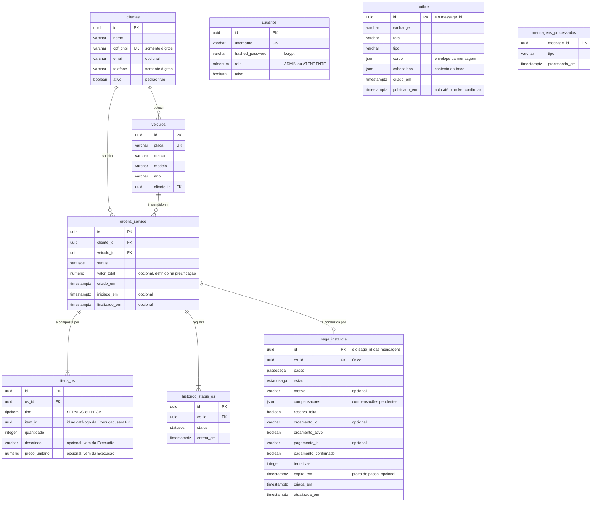

# Modelo de dados do OS Service

Banco PostgreSQL 16 exclusivo do OS Service (banco `os`, RDS `tech-challenge-f4-os-service-db` na nuvem),
versionado pelo Alembic em `alembic/versions`. Nenhum outro serviço lê ou escreve nele: a Lambda de CPF
consulta o cliente pela rota interna `POST /interno/clientes/autenticar` (ADR-022), e a Execução e o Billing
só trocam mensagens com este serviço (ADR-020).

O que é dado de outro serviço não está aqui:

| Dado | Dono | Como o OS Service o referencia |
|---|---|---|
| Catálogo de serviços e peças, estoque, reserva, fila de execução | Execução e Produção | `itens_os.item_id` guarda o id do catálogo, sem chave estrangeira; descrição e preço chegam na mensagem `PecasReservadas` |
| Orçamento, aprovação do cliente, cobrança e reembolso | Billing | `saga_instancia.orcamento_id` e `saga_instancia.pagamento_id` guardam os ids como texto |

## Diagrama ER



`outbox` e `mensagens_processadas` não têm chave estrangeira: são tabelas da mensageria, e não do domínio.

## Tabelas

Todas as chaves primárias são UUID criados pela aplicação (`uuid.uuid4`). A coluna "Nulo" indica se a coluna
aceita `NULL`.

### `usuarios`

Funcionários que operam a API. Clientes não têm senha: autenticam-se pelo CPF na Lambda.

| Coluna | Tipo | Nulo | Descrição |
|---|---|---|---|
| `id` | `uuid` | não | chave primária |
| `username` | `varchar(50)` | não | login; único |
| `hashed_password` | `varchar(255)` | não | hash bcrypt da senha |
| `role` | `roleenum` | não | `ADMIN` ou `ATENDENTE` |
| `ativo` | `boolean` | não | `false` depois de `DELETE /auth/usuarios/{id}` (a linha não é apagada) |

### `clientes`

| Coluna | Tipo | Nulo | Descrição |
|---|---|---|---|
| `id` | `uuid` | não | chave primária; é o `sub` do JWT de cliente |
| `nome` | `varchar(150)` | não | |
| `cpf_cnpj` | `varchar(18)` | não | só dígitos (11 de CPF ou 14 de CNPJ); único; imutável pela API |
| `email` | `varchar(150)` | sim | |
| `telefone` | `varchar(20)` | não | só dígitos (DDD mais número, 10 ou 11 dígitos pela API) |
| `ativo` | `boolean` | não | padrão `true`; com `false` o cliente deixa de autenticar pelo CPF |

### `veiculos`

| Coluna | Tipo | Nulo | Descrição |
|---|---|---|---|
| `id` | `uuid` | não | chave primária |
| `placa` | `varchar(10)` | não | formato `AAA-1234` ou Mercosul `AAA1A23`, em maiúsculas; única |
| `marca` | `varchar(60)` | não | |
| `modelo` | `varchar(60)` | não | |
| `ano` | `varchar(4)` | não | quatro dígitos entre 1900 e 2100 (validação da API) |
| `cliente_id` | `uuid` | não | FK para `clientes.id`; dono do veículo |

### `ordens_servico`

| Coluna | Tipo | Nulo | Descrição |
|---|---|---|---|
| `id` | `uuid` | não | chave primária |
| `cliente_id` | `uuid` | não | FK para `clientes.id` |
| `veiculo_id` | `uuid` | não | FK para `veiculos.id` |
| `status` | `statusos` | não | status atual da OS |
| `valor_total` | `numeric(10,2)` | sim | nulo até a Execução devolver os preços (`PecasReservadas`) |
| `criado_em` | `timestamptz` | sim | padrão `now()` |
| `iniciado_em` | `timestamptz` | sim | instante de entrada em `EM_EXECUCAO` |
| `finalizado_em` | `timestamptz` | sim | instante de entrada em `FINALIZADA` |

### `itens_os`

| Coluna | Tipo | Nulo | Descrição |
|---|---|---|---|
| `id` | `uuid` | não | chave primária |
| `os_id` | `uuid` | não | FK para `ordens_servico.id` |
| `tipo` | `tipoitem` | não | `SERVICO` ou `PECA` |
| `item_id` | `uuid` | não | id do serviço ou da peça no catálogo da Execução; sem FK |
| `quantidade` | `integer` | não | maior que zero |
| `descricao` | `varchar(150)` | sim | nula até a precificação |
| `preco_unitario` | `numeric(10,2)` | sim | nulo até a precificação; fica congelado no item |

### `historico_status_os`

Uma linha por entrada da OS em um status, a começar pela abertura (`ABERTA`).

| Coluna | Tipo | Nulo | Descrição |
|---|---|---|---|
| `id` | `uuid` | não | chave primária |
| `os_id` | `uuid` | não | FK para `ordens_servico.id` |
| `status` | `statusos` | não | status em que a OS entrou |
| `entrou_em` | `timestamptz` | não | instante da entrada; a diferença entre linhas consecutivas da mesma OS é o tempo no status |

### `saga_instancia`

Estado do orquestrador: uma linha por OS. O `id` da linha é o `saga_id` que viaja nas mensagens.

| Coluna | Tipo | Nulo | Descrição |
|---|---|---|---|
| `id` | `uuid` | não | chave primária; `saga_id` |
| `os_id` | `uuid` | não | FK para `ordens_servico.id`; único (uma Saga por OS) |
| `passo` | `passosaga` | não | passo em que a Saga está ou parou |
| `estado` | `estadosaga` | não | `EM_ANDAMENTO`, `COMPENSANDO`, `CONCLUIDA`, `COMPENSADA` ou `FALHA_NA_COMPENSACAO` |
| `motivo` | `varchar(40)` | sim | por que a Saga entrou em compensação (por exemplo `PAGAMENTO_EXPIRADO`) |
| `compensacoes` | `json` | não | lista ordenada das compensações ainda pendentes; a primeira é a que está em curso |
| `reserva_feita` | `boolean` | não | há reserva de peças a liberar |
| `orcamento_id` | `varchar(64)` | sim | id do orçamento no Billing |
| `orcamento_ativo` | `boolean` | não | há orçamento a cancelar |
| `pagamento_id` | `varchar(64)` | sim | id do pagamento no Billing |
| `pagamento_confirmado` | `boolean` | não | há pagamento a reembolsar |
| `tentativas` | `integer` | não | reenvios de `EnfileirarOS` no passo `ENFILEIRANDO` |
| `expira_em` | `timestamptz` | sim | prazo do passo atual; nulo quando não há prazo |
| `criada_em` | `timestamptz` | sim | padrão `now()` |
| `atualizada_em` | `timestamptz` | sim | padrão `now()`; o ORM a atualiza a cada `UPDATE` |

As três colunas booleanas (`reserva_feita`, `orcamento_ativo`, `pagamento_confirmado`) dizem o que a Saga
precisa desfazer se falhar. Ao compensar, a Saga monta `compensacoes` do efeito mais recente para o mais
antigo: `Reembolsar`, `CancelarOrcamento`, `LiberarReserva`. Cada confirmação do participante remove a
primeira entrada da lista e zera a coluna correspondente. O algoritmo completo está no README, seção
*A Saga*.

### `outbox`

Mensagens a publicar, gravadas na mesma transação da mudança de estado que as originou (ADR-021).

| Coluna | Tipo | Nulo | Descrição |
|---|---|---|---|
| `id` | `uuid` | não | chave primária; é o `message_id` do envelope e da propriedade AMQP |
| `exchange` | `varchar(60)` | não | hoje sempre `oficina.comandos` |
| `rota` | `varchar(80)` | não | routing key, por exemplo `execucao.reservar-pecas` |
| `tipo` | `varchar(40)` | não | nome da mensagem, por exemplo `ReservarPecas` |
| `corpo` | `json` | não | envelope completo (`message_id`, `tipo`, `versao`, `saga_id`, `os_id`, `ocorrido_em`, `origem`, `payload`) |
| `cabecalhos` | `json` | não | cabeçalhos AMQP do trace distribuído; `{}` com o agente New Relic desligado |
| `criado_em` | `timestamptz` | não | padrão `now()`; define a ordem de publicação |
| `publicado_em` | `timestamptz` | sim | nulo enquanto o broker não confirmar; o relay só lê as linhas com este campo nulo |

### `mensagens_processadas`

Inbox: registro das mensagens já consumidas, para ignorar entregas repetidas.

| Coluna | Tipo | Nulo | Descrição |
|---|---|---|---|
| `message_id` | `uuid` | não | chave primária; `message_id` da mensagem recebida |
| `tipo` | `varchar(40)` | não | nome do evento |
| `processada_em` | `timestamptz` | não | padrão `now()` |

## Tipos enumerados

Enums nativos do PostgreSQL, criados pelas migrations.

| Tipo | Valores |
|---|---|
| `statusos` | `ABERTA`, `AGUARDANDO_APROVACAO`, `AGUARDANDO_PAGAMENTO`, `NA_FILA`, `EM_DIAGNOSTICO`, `EM_EXECUCAO`, `FINALIZADA`, `ENTREGUE`, `NEGADA`, `CANCELADA` |
| `roleenum` | `ADMIN`, `ATENDENTE` |
| `tipoitem` | `SERVICO`, `PECA` |
| `passosaga` | `RESERVANDO_PECAS`, `GERANDO_ORCAMENTO`, `AGUARDANDO_APROVACAO`, `AGUARDANDO_PAGAMENTO`, `ENFILEIRANDO`, `EM_EXECUCAO` |
| `estadosaga` | `EM_ANDAMENTO`, `COMPENSANDO`, `CONCLUIDA`, `COMPENSADA`, `FALHA_NA_COMPENSACAO` |

As transições permitidas entre os valores de `statusos` não ficam no banco: quem as controla é o agregado
`OrdemDeServico` (`app/domain/entities/os.py`). O mapa está no README, seção *Máquina de estados da OS*.

## Relacionamentos

| Relação | Cardinalidade | O que o modelo garante |
|---|---|---|
| `clientes` → `veiculos` | 1 : N | todo veículo tem dono (`cliente_id NOT NULL`) |
| `clientes` → `ordens_servico` | 1 : N | a OS guarda o cliente diretamente, então "minhas ordens de serviço" não depende do veículo |
| `veiculos` → `ordens_servico` | 1 : N | toda OS é de um veículo cadastrado |
| `ordens_servico` → `itens_os` | 1 : N | item não existe sem OS; a abertura exige ao menos um item (validação da API) |
| `ordens_servico` → `historico_status_os` | 1 : N | uma linha por entrada em um status |
| `ordens_servico` → `saga_instancia` | 1 : 0..1 | `UNIQUE (os_id)`; a Saga é criada na mesma transação da OS, então na prática toda OS tem uma |

`usuarios`, `outbox` e `mensagens_processadas` não se relacionam com as demais tabelas.

## Índices e restrições

Nomes como o PostgreSQL os criou a partir das migrations.

| Tabela | Restrição ou índice | Atende |
|---|---|---|
| `usuarios` | `ix_usuarios_username` (único) | login |
| `clientes` | `clientes_cpf_cnpj_key` (único) | busca por documento, inclusive a da Lambda |
| `veiculos` | `veiculos_placa_key` (único) · `ix_veiculos_cliente_id` | veículos de um cliente |
| `ordens_servico` | `ix_ordens_servico_status` · `ix_ordens_servico_cliente_id` | filtro por status e "minhas OS" |
| `itens_os` | `ix_itens_os_os_id` | itens de uma OS |
| `historico_status_os` | `ix_historico_status_os_os_id` | histórico de uma OS e métrica de tempo por status |
| `saga_instancia` | `saga_instancia_os_id_key` (único) · `ix_saga_instancia_estado` · `ix_saga_instancia_expira_em` | Saga de uma OS e varredura de prazos |
| `outbox` | `ix_outbox_pendentes` em (`publicado_em`, `criado_em`) | relay: o que falta publicar, em ordem |
| `mensagens_processadas` | chave primária em `message_id` | idempotência do consumidor |

Chaves estrangeiras: `veiculos.cliente_id`, `ordens_servico.cliente_id`, `ordens_servico.veiculo_id`,
`itens_os.os_id`, `historico_status_os.os_id` e `saga_instancia.os_id`. Nenhuma declara `ON DELETE`: o
banco recusa remover um cliente, veículo ou OS que ainda seja referenciado.

### Restrições CHECK

A API já valida estes limites nos schemas e nos casos de uso. O banco os repete para que nenhum caminho,
nem um script manual, grave dado inconsistente.

| Tabela | Nome | Regra |
|---|---|---|
| `ordens_servico` | `ck_ordens_servico_valor_nao_negativo` | `valor_total` nulo ou maior ou igual a zero |
| `itens_os` | `ck_itens_os_quantidade_positiva` | `quantidade > 0` |
| `itens_os` | `ck_itens_os_preco_nao_negativo` | `preco_unitario` nulo ou maior ou igual a zero |

## Decisões de modelagem

- **UUID como chave primária.** Criado pela aplicação; um id na URL não revela volume nem permite adivinhar o
  próximo registro. O `id` da OS e o da Saga também são os identificadores que circulam nas mensagens.
- **`NUMERIC(10,2)` para dinheiro.** Sem erro de arredondamento de ponto flutuante. Nas mensagens o dinheiro
  trafega como texto com duas casas (`"150.00"`) e volta para `Decimal` na precificação.
- **Enum nativo para status, papel, tipo de item, passo e estado da Saga.** O banco recusa um valor
  inexistente.
- **Item sem chave estrangeira para o catálogo.** O catálogo pertence à Execução (ADR-017). O item guarda
  `tipo` e `item_id`, e a descrição e o preço ficam copiados no item quando a Execução responde; reajustar o
  catálogo depois não altera uma OS já orçada.
- **Itens nascem sem preço.** `descricao` e `preco_unitario` são nulos na abertura, e `valor_total`, também. A
  precificação (`OrdemDeServico.precificar`) os preenche quando chega `PecasReservadas`.
- **Status atual na OS, trajetória no histórico.** A OS diz onde está sem varrer o histórico, e o histórico diz
  quanto tempo ela passou em cada status. `iniciado_em` e `finalizado_em` ficam na OS, usados pela métrica de
  tempo de execução.
- **Estado da Saga em linha própria.** Passo, estado, flags de efeito e prazo ficam consultáveis numa linha
  (`SELECT` direto ou campo `saga` da resposta de `GET /atendimento/os/{id}`), em vez de reconstruídos a
  partir de eventos.
- **Flags de efeito em vez de inferência.** `reserva_feita`, `orcamento_ativo` e `pagamento_confirmado`
  registram o que existe nos outros serviços. Quando um prazo esgota sem resposta, a Saga assume que o passo
  em curso pode ter produzido efeito e marca a flag correspondente; a compensação é idempotente.
- **`timestamptz`.** Datas comparáveis independentemente do fuso de quem grava. O ORM devolve sempre UTC
  (`DataHoraUTC`).
- **CPF/CNPJ apenas com dígitos.** O value object `CpfCnpj` normaliza antes de gravar, então
  `529.982.247-25` e `52998224725` caem na mesma restrição de unicidade.
- **Outbox e inbox no mesmo banco do domínio.** A mudança de estado e a mensagem a publicar são gravadas na
  mesma transação; o `message_id` consumido é gravado na transação do efeito (ADR-021).
- **Desativar em vez de apagar.** Usuário e cliente são desativados (`ativo = false`) e continuam no banco.
  Só o veículo é removido de fato.

## Concorrência

| Onde | Como |
|---|---|
| Alteração de OS ou de Saga | `SELECT ... FOR UPDATE`. Os casos de uso da Saga travam sempre a Saga e depois a OS, na mesma ordem, para não gerar deadlock |
| Relay do outbox | `SELECT ... FOR UPDATE SKIP LOCKED` em lotes de 50: cada processo pega linhas diferentes |
| Varredura de prazos | `SELECT ... FOR UPDATE SKIP LOCKED` em lotes de 50 Sagas vencidas (`estado` `EM_ANDAMENTO` ou `COMPENSANDO` e `expira_em` no passado) |
| Inbox | `INSERT` em `mensagens_processadas` dentro de um savepoint; a violação da chave primária indica mensagem repetida, e o caso de uso retorna sem efeito |

Itens, histórico e Saga de uma OS são carregados em lote (`selectin`): listar várias ordens de serviço não faz
uma consulta por OS.

## Migrations

| Revisão | Mudança |
|---|---|
| `0001` | `usuarios`, `clientes`, `veiculos`, `ordens_servico`, `itens_os` e `historico_status_os`, com os enums `roleenum`, `tipoitem` e `statusos`, os índices e as restrições `CHECK` |
| `0002` | `saga_instancia`, `outbox` e `mensagens_processadas`, com os enums `passosaga` e `estadosaga` e os índices de prazo, de estado e de publicação pendente |

- O `entrypoint.sh` executa `alembic upgrade head` a cada subida do container; com o banco já atualizado, não
  altera nada. O mesmo comando roda no `docker compose` local.
- O `alembic/env.py` lê `DATABASE_URL` do ambiente e escapa `%`, porque a senha do RDS vai codificada na URL.
- O downgrade de cada revisão remove tabelas, índices e tipos (`tipoitem`, `statusos`, `roleenum`,
  `estadosaga` e `passosaga`). Subir, descer até a base e subir de novo funciona num PostgreSQL 16 vazio.
- Os testes unitários usam SQLite em memória, criado a partir do mapeamento (`metadata.create_all`). As
  migrations são exercitadas contra um PostgreSQL real no job `imagem` do CI, onde o entrypoint migra um
  banco vazio.

## Consultas úteis

Com `DATABASE_URL` apontando para o banco:

```sql
-- Sagas por passo e estado
SELECT passo, estado, count(*) FROM saga_instancia GROUP BY passo, estado ORDER BY 1, 2;

-- Sagas paradas na compensação do reembolso, que exigem ação humana
SELECT id, os_id, motivo, compensacoes FROM saga_instancia WHERE estado = 'FALHA_NA_COMPENSACAO';

-- Mensagens que o relay ainda não publicou
SELECT tipo, rota, criado_em FROM outbox WHERE publicado_em IS NULL ORDER BY criado_em;

-- Tempo em cada status de uma OS
SELECT status, entrou_em,
       lead(entrou_em) OVER (ORDER BY entrou_em) - entrou_em AS tempo_no_status
FROM historico_status_os WHERE os_id = '<id da OS>' ORDER BY entrou_em;
```

`outbox` e `mensagens_processadas` não têm rotina de limpeza: as linhas ficam no banco depois de publicadas ou
processadas.
